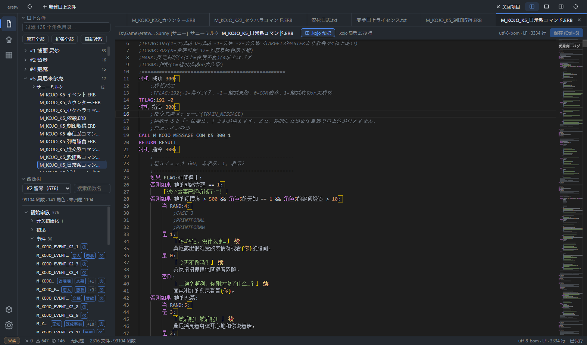

<div align="center">    
  

# kojo-editor

**简体中文** | [English](README_EN.md) | [日本語](README_JA.md)


> 给口上作者的编辑器。  
> 几千份口上文件、几万个函数，不用再「记事本 + 全文搜索」——  
> 浏览、校验、试写、回放，一站完成。



</div>

---

## 为什么做这个

era 系游戏（eraTW 等）的口上生态已经积累了非常可观的规模：两千多份口上文件、  
九万多个函数。但作者手里的工具，至今还是原始。

于是这些事每天都在发生：

- 函数名写错一个字母，**整段口上静默失效**——游戏里没人说话，也不报错；
- 想知道「这句台词什么时候触发」，只能全文搜索，在几十个同名函数里翻；
- 改一行台词要「开游戏 → 玩到对应状态 → 肉眼验收」，深层条件得刷十几分钟；
- 文件编码五花八门，一存盘，乱码就来了。

kojo-editor 想把这一切变成「打开就知道、改完就确认」。

## 它能做什么

**🗂 结构化浏览**  
打开游戏目录，口上文件按角色归类，函数按「角色 → 家族 → 面」成树展开，  
条件徽章一眼可见，点击直达。九万多个函数，索引只要几秒。

**✅ 写错即报**  
函数名拼错、家族缺件、格式不符——「约定校验」面板把问题列成清单，  
点一条直接跳到出问题的那一行。错误不再静默。

**✍️ 用「.kojo 语言」写口上**  
一门为口上设计的中文书写语言：`如果 好感度 ≤ 5：` 这样的语感，  
保存时自动编译成游戏原样读取的脚本文件——原编码、原换行，一字不乱地保持。  
不想改写的部分照旧手写原文件，两种方式可以混用。

**▶ 状态回放**  
选一份存档、一个角色，每条触发条件的真假、分支走向直接铺开。  
不用开游戏刷状态，写完当场看效果。

**💉 状态注入**  
想把某个好感度调到指定值来测试？写入**测试存档**——两步确认、自动备份、  
回读验证。真实存档和游戏本体永远只读。

## 安装

目前需要从源码构建（预编译安装包将随 v0.4.0-beta.1 发布）：

```bash
# 前置：Node.js 22+ 与 Rust 工具链（rustup）
pnpm install
pnpm --filter @kojo/app tauri dev   # 首次编译约 20-30 分钟
```

首次启动：选择游戏目录 → 工具自动识别并索引 → 完成。  
不批准写权限也完全可用（浏览、校验、回放都是只读的）。

## 开发

```bash
pnpm test               # 全量测试（2473+ 通过；未设游戏目录时部分集成用例自动跳过）
pnpm typecheck          # 类型检查（root + app 双跑）
pnpm audit:decoupling   # 「一切皆插件」解耦审计
```

架构采用**一切皆插件**的设计：内核零游戏知识，扩展新游戏 = 新增一个适配器插件。  
设计细节见 [ARCHITECTURE.md](docs/ARCHITECTURE.md)，  
协作与贡献流程见 [AGENTS.md](AGENTS.md)。

## 路线

| 版本            | 内容                              | 状态     |
| ------------- | ------------------------------- | ------ |
| v0.1          | 内核 + 插件运行时 + 桌面壳                | ✅      |
| v0.2          | 校验 / 导航 / 条件抽取 / 回放 / 注入器       | ✅      |
| v1.0–v1.1     | 快照回放收口 + 状态注入器                  | ✅      |
| v0.3          | .kojo 语言全链路（编辑、编译、保存）           | ✅      |
| v0.4.0-beta.1 | 保存闭环 · 文件监视 · 自动更新 · 设置页 · 打包分发 | 🚧 进行中 |

## 反馈

遇到问题或有想提的功能，欢迎[提交 Issue](https://github.com/Poboking/kojo-editor/issues)。

开发者：[**Poboking**](https://github.com/Poboking)  
<a href="https://github.com/Poboking"></a>

## 许可

[GPL-3.0-or-later](LICENSE)（内核与工具代码）。

仓库不内置任何游戏内容——截图与测试所需的口上文件均来自本机已安装的游戏。  
感谢 eraTW 及整个 era 社区多年来的创作积累。
