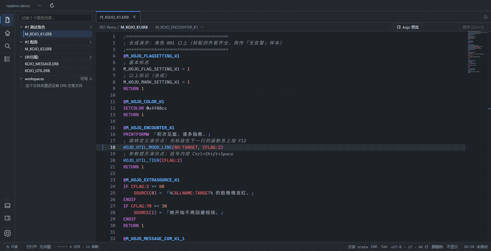
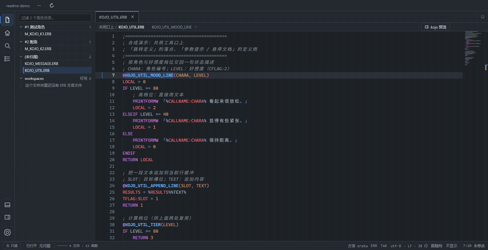
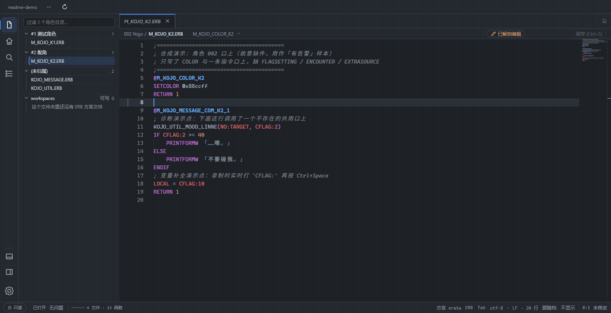
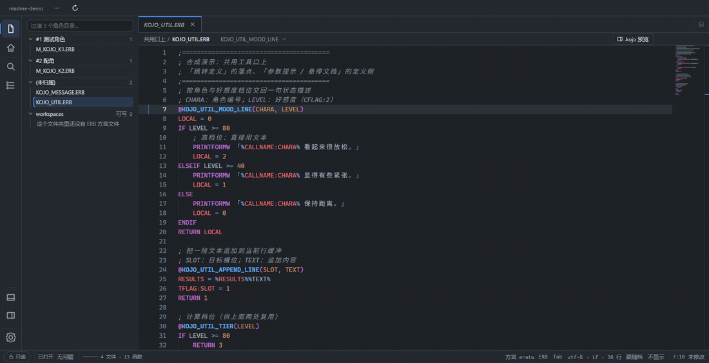
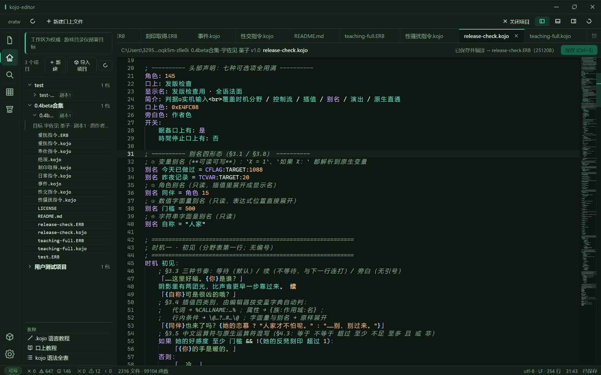
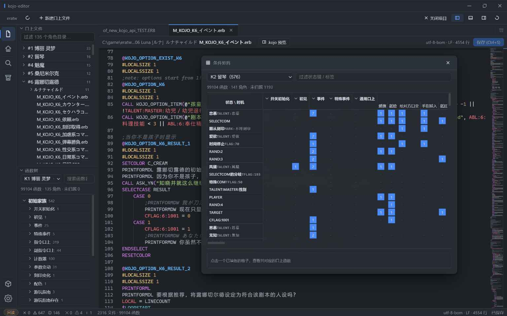
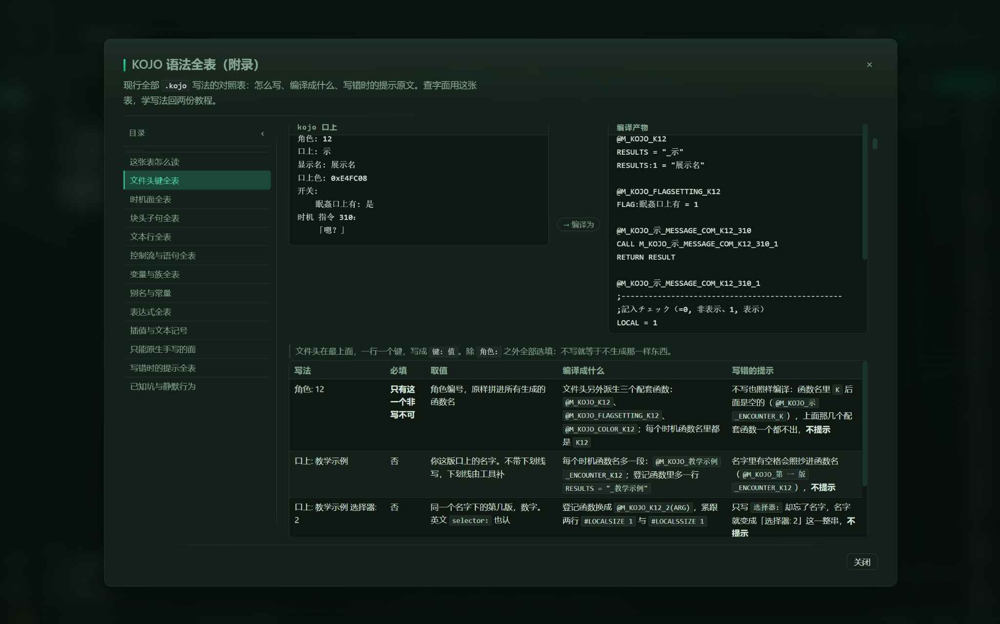
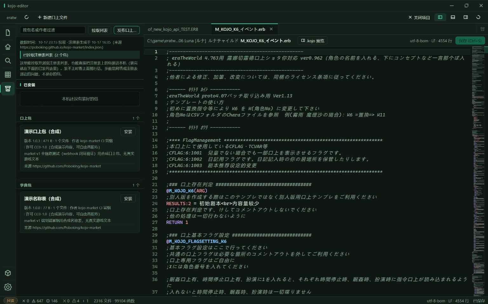
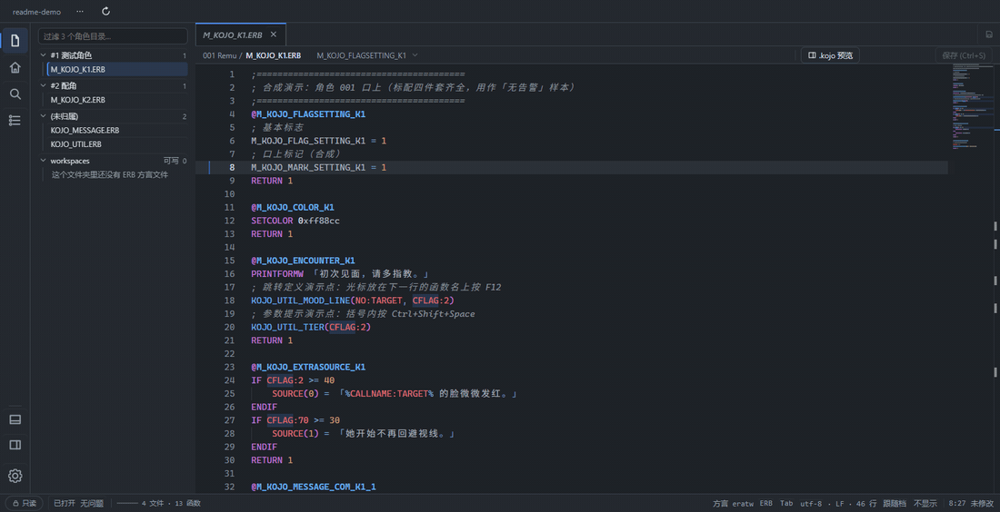
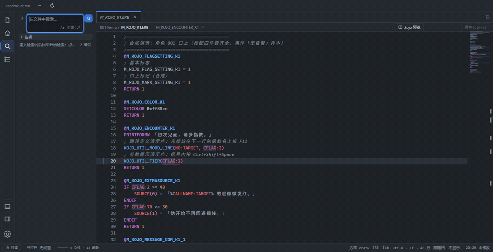

<div align="center">
  

# kojo-editor

**简体中文** | [English](README_EN.md) | [日本語](README_JA.md)


**给 era 系口上脚本（`.ERB` / `.kojo`）的结构感知 IDE。**  
Tauri 2 壳（Rust 只做 IO 原语）+ React 19 + Monaco，pnpm monorepo。  
**内核零游戏知识，一切皆插件。** Windows 10 / 11 x64。

</div>

## 演示

六枚动图都**从真界面录出来**，一条命令可重录（方法在 [docs/DEVELOPER-GUIDE.md](docs/DEVELOPER-GUIDE.md) §8）；演示数据全为合成样本，见文末「许可与致谢」。

这里不把它们堆成一屏——**一枚动图配一段说明**，各归各的能力：先看最能说明「结构感知」的这一枚，其余分别贴在 §ERB 语言面一览 与 §编辑器的底子 里。

<div align="center">
  
  <br><sub><b>跳转定义</b> <code>F12</code> —— 光标停在调用处，跳进<b>另一份文件</b>里的定义</sub>
</div>

## 先看你是谁

| 你 | 从这里开始 |
|---|---|
| **想读懂、改写别人的口上，不打算写代码** | 下载安装 → 按 [docs/USER-GUIDE.md](docs/USER-GUIDE.md) §3 打开游戏目录（**可以拒绝写权限**，只读浏览照常）→ 用「`.kojo` 预览」把 `.ERB` 就地显示成中文表层写法 |
| **会写 ERB，想用自己的语法写、一键进游戏** | [docs/USER-GUIDE.md](docs/USER-GUIDE.md) §7 新建口上项目 → §8 语言面与保存流程（`.kojo` 2.0 现在能做到哪一步见 §8.8）→ §10 导出 / 部署 |
| **要读代码、加插件、接一款新 era 游戏** | [docs/DEVELOPER-GUIDE.md](docs/DEVELOPER-GUIDE.md)（环境 / 验证矩阵 / 语言面装配 / 插件与适配器 / 发版）+ [AGENTS.md](AGENTS.md)（铁律与协作纪律，动手前必读） |

三条路共用同一套判据：工具的每一次跳转、每一条告警，都来自能被单测钉住的纯函数，而不是「看起来像 ERB」的正则。

## 它要解决的那件事

ERB 是 1998 年时代的行式脚本：没有 LSP、没有 AST 工具链、没有包管理。一份真实工程 **3,971 份方言文件 / 110,049 个函数定义**（eraTW 4.980 基线盘实测，口径见 [docs/STATE.md](docs/STATE.md)），口上函数靠**命名约定**互相调用（`M_KOJO_{角色}_MESSAGE_COM_{指令}`）——改一个角色的写法，调用点散在整个工程；函数名拼错，引擎**静默不生效**。

所以缺的不是「再加一个语法高亮」，而是一整套 IDE 面：**索引 → 符号 → 引用 → 诊断 → 改写**。本项目把它做成三层可审计的东西——判据住库包（纯函数、零 Monaco、零 IO）、宿主只做装配与翻译、游戏知识只能住适配器插件（`pnpm audit:decoupling` 与 `pnpm audit:language` 双向守门）。

## ERB 语言面一览

> 键位都是缺省值，绝大多数可在应用内「键位」页改绑（三枚内建项暂不支持：写作模式 `Ctrl+K Z`、保存 `Ctrl+S`、在选定内容中查找 `Ctrl+Alt+F`）。判据与装配的代码位置在 [docs/DEVELOPER-GUIDE.md](docs/DEVELOPER-GUIDE.md) §6。

| 能力 | 缺省键位 |
|---|---|
| 跳转定义（跨文件）· 速览定义 · 跳到实现 | `F12` · `Alt+F12` · `Ctrl+F12` |
| 查找引用（peek 浮窗 + 跨文件计数） | `Shift+F12` |
| 悬停文档（作者注释 + 形参表 + 定义落点） | `Ctrl+K Ctrl+I` |
| 参数提示（当前参数位高亮） | `Ctrl+Shift+Space` |
| 补全（触发字符 `#` `[` `@` `$` `.`；输入即弹） | `Ctrl+Space` |
| 实时校验（波浪线 + 问题面板 + 状态栏计数） | `Ctrl+Shift+M` 面板 · `Alt+F8` 逐条 |
| 重命名符号（跨文件一起改） | `F2` |
| 文档符号 / 转到本文件符号 | `Ctrl+Shift+O` |
| 同符号高亮 · 扩选 · code lens | `Ctrl+D` · `Shift+Alt+→` · 行内 |
| 折叠（按函数体 / 区块） | 编辑器左侧折叠条 |

三枚动图对应上面表里的三行，一张配一句话：

<table>
  <tr>
    <td width="46%" align="center"></td>
    <td valign="middle"><b>查找引用</b> <code>Shift+F12</code><br>
    peek 浮窗按文件分组给出命中数。口上函数靠命名约定互调，改一处之前得先看清调用点散在哪几份文件里——全文 Grep 给的是行数，这里给的是「谁在调它」。</td>
  </tr>
</table>

<table>
  <tr>
    <td valign="middle"><b>补全</b> <code>Ctrl+Space</code> / 输入即弹<br>
    候选按<b>名槽</b>出货：台词、旁白、注释、字符串段里不弹，触发字符是 <code>#</code> <code>[</code> <code>@</code> <code>$</code> <code>.</code>。不是把整张词表糊在你脸上，而是先问「这一格该出现什么」。</td>
    <td width="46%" align="center"></td>
  </tr>
</table>

<table>
  <tr>
    <td width="46%" align="center"></td>
    <td valign="middle"><b>折叠</b> 按函数体 / 区块<br>
    区间来自 tree-sitter CST，不靠正则数 <code>IF/ENDIF</code>。一份上万行的口上文件，能按结构收起来才谈得上读；真实语料的折叠起点召回率与逐行对拍读数记在 <a href="docs/STATE.md">docs/STATE.md</a>。</td>
  </tr>
</table>

## 给口上作者的成品面板

这些是插件，不是宿主代码；用法都在 [docs/USER-GUIDE.md](docs/USER-GUIDE.md)。

<table>
  <tr>
    <td width="50%" align="center"><br><sub><b>主界面</b> —— 左侧口上项目树与教程入口，中间多标签编辑 `.kojo` / `.ERB` / `.md`，状态栏给可写徽章与诊断计数</sub></td>
    <td width="50%" align="center"><br><sub><b>条件矩阵</b> —— 状态键 × 时机面摊成一张表，点已填色的格子跳到对应口上函数（浮窗形态）</sub></td>
  </tr>
  <tr>
    <td width="50%" align="center"><br><sub><b>KOJO 语法全表（附录）</b> —— 怎么写、编译成什么、写错时提示原文，逐条对照；左侧目录 13 张全表</sub></td>
    <td width="50%" align="center"><br><sub><b>口上市场</b> —— 拉取注册表、浏览并安装别人发布的口上包与字典包（图示为 CI 的合成演示包）</sub></td>
  </tr>
</table>

> 四张截图摄于 2026-10-20 的界面；面板归位随批次会调整，以应用内实际为准。动图不受此限（重录即当前形状）。

面板清单的准确口径（含哪些**缺省封存**、哪些**只在 kojo1 档出现**）见 [docs/USER-GUIDE.md](docs/USER-GUIDE.md) §6.3——我们把「找不到面板」当成文档缺陷，而不是使用者的问题。

## 编辑器的底子

- **编码与换行逐字节保持**：按声明编码读取（Shift-JIS / GBK / UTF-8 / UTF-16），写回保持原文件的 EOL 与 BOM 形态——改一行不会把整份文件重排。
- **游戏目录默认只读**：第一次真键入弹确认；解锁只在**这一份文件、这一次会话**有效，重启回到默认只读。你自己的作品住在常驻可写的工作区，不受影响。
- **写盘只有三条互不继承的授权通道**：内核 `writablePaths`、`exportFile`（系统对话框即授权）、启动器 `launcher/approvals.json`。
- **一切能力都有可编程入口**：命令面板 100+ 条、键位可改绑，调试 CLI 用同一条腿驱动界面——本文那几枚动图就是这条腿录出来的。
- **多编辑器组与多光标**：拆分（`Ctrl+\`）、`Ctrl+1..4` 聚焦、列编辑、移行、`Ctrl+Shift+L` 全加。

<table>
  <tr>
    <td width="46%" align="center"></td>
    <td valign="middle"><b>命令面板</b> <code>Ctrl+Shift+P</code><br>
    100+ 条命令都能在这儿搜到、执行、改绑键位（三枚内建项暂不可改）。面板找不到时别翻菜单——命令面板是同一个入口，界面上有的东西，命令表里都有。</td>
  </tr>
</table>

<table>
  <tr>
    <td valign="middle"><b>全工程检索</b><br>
    命中按文件分组给出（图示 10 条 · 4 个文件）。配合上面的「查找引用」一起用：知道符号叫什么就用引用，只记得一句台词或一个片段才用检索。</td>
    <td width="46%" align="center"></td>
  </tr>
</table>

## 质量口径

一句话：**任何「改好了」都必须带数**。

- 功能池 **1,184 文件 · 22,491 passed / 0 failed / 149 skipped**（2026-11-02 档；跳过条数随语料在位与否变动）· 计时池 31 文件；
- 双 typecheck（root + app）· 四份审计（解耦 A–D / 语言面棘轮 / 裸字节 / 看板）· 开机图体积闸 · Rust 侧 `cargo test --lib` 独立闸；
- 插件 **31 枚**，含 **8 个** era 系游戏适配器；
- 真语料读数（热载 `read+parse 0ms` / `refs scan 2ms`、内存与冷开剖面、折叠对拍）**逐批记账在 [docs/STATE.md](docs/STATE.md)**——那里是数字的唯一真源，本文这张快照会过期。

## 现在的边界（诚实清单）

我们更愿意把没做完的事写在这里，而不是让你在踩到之后再找我们：

- **`.kojo`（Kojo 2.0）目前只到编辑 / 上色 / 诊断 / 预览**。保存时编译出 `.ERB`、以及导出 / 部署的转译链，当前只认封存层 `.kojo1` 与原生 `.ERB`（判据是 `resolveSugarTarget`）。**后果要说清楚**：拿 `.kojo` 去导出或部署，工具会把 `.kojo` 原样带进包里，引擎读不到它，而导出**不会报错**——急着让稿子进游戏，请用 `.ERB` 或 `.kojo1` 新建。
- **平台只有 Windows 10 / 11 x64**；macOS / Linux 未做。
- **安装包未做代码签名**：首次运行可能遇到 SmartScreen「Windows 已保护你的电脑」，可对每个 Release 附带的 `SHA256SUMS.txt` 自行核验后再放行。签名只做在自动更新通道上。
- **预发布版（版本号含 `-`）不进稳定更新通道**，需手动到 Release 页面下载安装。
- ERB 波浪线对 `CASE` / `PRINTDATA` 的条件采取**保守排除**，是已知盲区；`.kojo` 预览暂未覆盖的行（循环、`TRY`、`SIF` 分支、数据表、赋值与调用）保持原样显示，不藏起来。
- **函数索引不做增量重建**：外部新建 / 改动的文件靠文件监视上树，新函数需要「重载项目」才进索引。

剩余欠账的逐条口径见 [docs/STATE.md](docs/STATE.md) §四。

## 我要把它跑起来

```bash
corepack enable && pnpm install
pnpm dev                            # 只起前端（vite，浏览器里跑，无桌面壳）
pnpm --filter @kojo/app tauri dev   # 桌面壳开发（首次 cargo 编译约 20–30 分钟）
pnpm test                           # 两池全量；pnpm typecheck / pnpm audit:decoupling 同理
```

依赖：Node.js 22 · pnpm 11.22.0（`packageManager` 固定）· Rust stable ≥ 1.77（仅桌面壳）· WebView2。
完整的环境矩阵、验证矩阵、插件与方言接入、演示录制、发版流程：**[docs/DEVELOPER-GUIDE.md](docs/DEVELOPER-GUIDE.md)**。

## 文档地图

| 文档 | 用途 |
|---|---|
| [docs/USER-GUIDE.md](docs/USER-GUIDE.md) | **给口上作者的使用手册**（只讲怎么用，不讲实现；当前仅中文） |
| [docs/DEVELOPER-GUIDE.md](docs/DEVELOPER-GUIDE.md) | 开发者手册：环境 / 验证矩阵 / 语言面装配 / 插件与适配器 / 调试与录制 / 发版 |
| [AGENTS.md](AGENTS.md) | 协作总入口：铁律、命令、Git 与文档纪律 |
| [docs/STATE.md](docs/STATE.md) | 基线数字唯一真源（测试数 / 体积 / 内存 / 性能 / 语料 / 欠账） |
| [docs/ARCHITECTURE.md](docs/ARCHITECTURE.md) · [docs/adr/](docs/adr/) | 分层与槽位的设计取舍、逐条决策记录 |
| [docs/KOJO-2.0-LANGUAGE-SPEC.md](docs/KOJO-2.0-LANGUAGE-SPEC.md) · [docs/SYNTAX-SUGAR-SURFACE-SPEC.md](docs/SYNTAX-SUGAR-SURFACE-SPEC.md) | `.kojo` 2.0 语言规格 · `.kojo1` 表层语法完整规格 |
| [docs/DIALECT-AUTHORING.md](docs/DIALECT-AUTHORING.md) | 新方言 / 新游戏接入五步 |
| [docs/DEBUG-MODE.md](docs/DEBUG-MODE.md) | 调试模式手册 + 扩展规范 |
| [docs/BOARD.md](docs/BOARD.md) · [docs/PITFALLS.md](docs/PITFALLS.md) | 在办看板 · 硬坑台账 |

贡献走「一条批次分支 → 过 dev 窄门」：分支模型、门槛与提交规范以 [AGENTS.md](AGENTS.md) §四为准，动手前请先读它和 [docs/PITFALLS.md](docs/PITFALLS.md)。

## 许可与致谢

[GPL-3.0-or-later](LICENSE)。仓库不内置任何游戏内容：README 的动图与截图全部来自 `tools/gif-scenarios/demo-project/` 与 `fixtures/` 的**合成样本**；测试所需的真实语料只在本机已安装、由用户自行授权的目录里被**只读**访问。

感谢 eraTW 与整个 era 社区多年来的创作积累——这个工具只是把大家口口相传的「命名约定」写成了可以互相检查的形状。

开发者：[**Poboking**](https://github.com/Poboking) · 问题与建议欢迎开 [Issue](https://github.com/Poboking/kojo-editor/issues)
