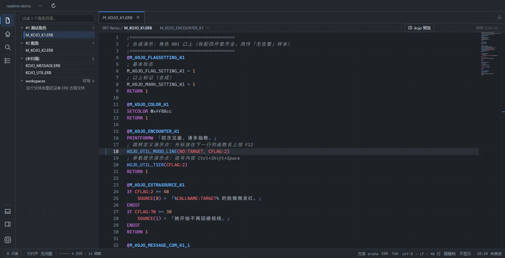
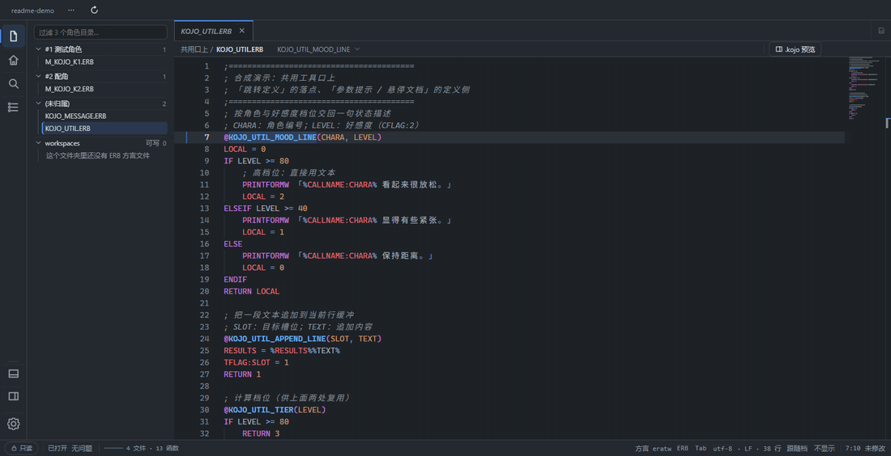
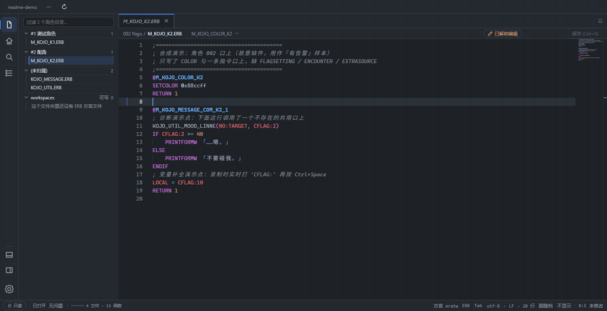
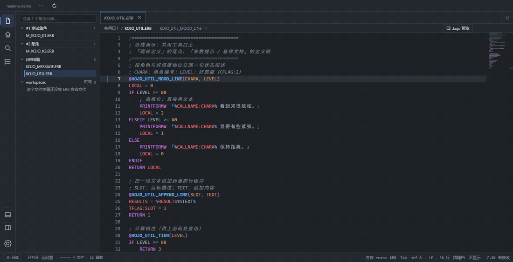
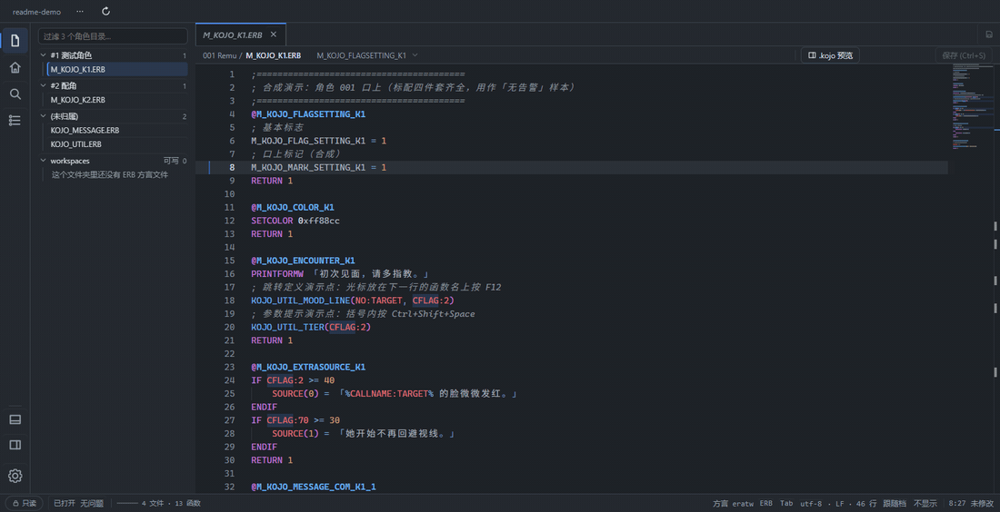
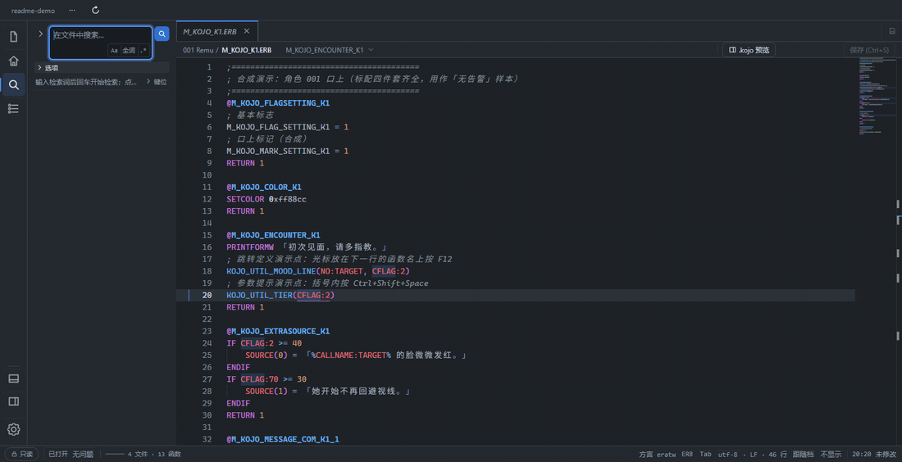
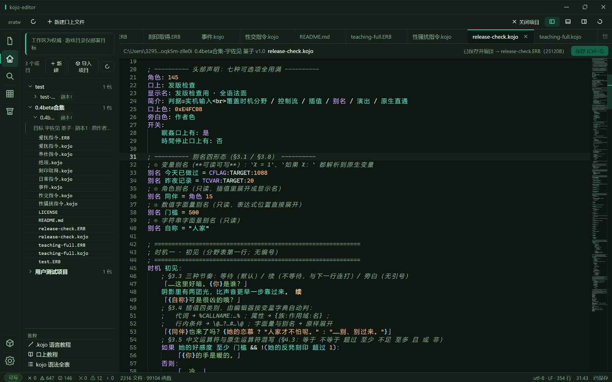
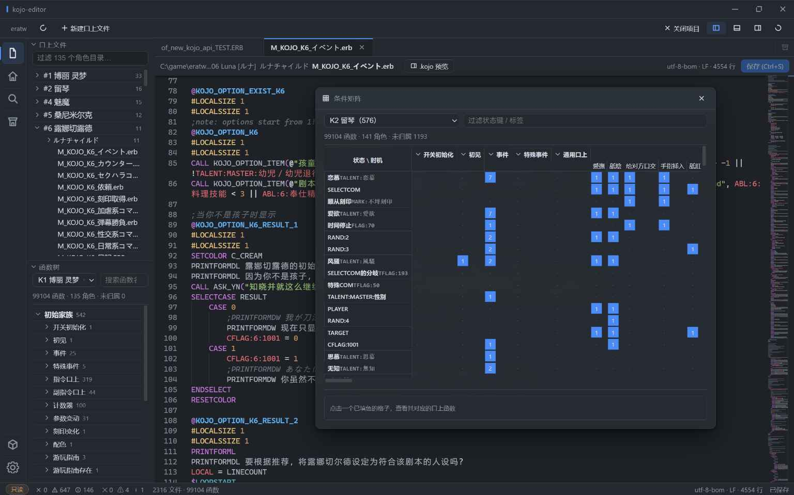
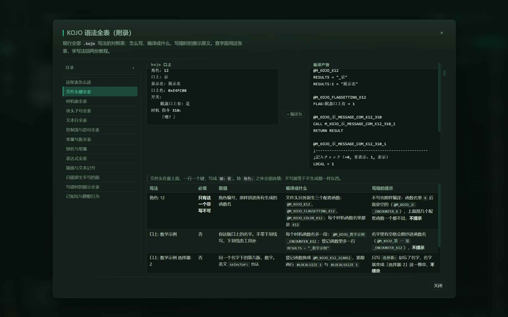
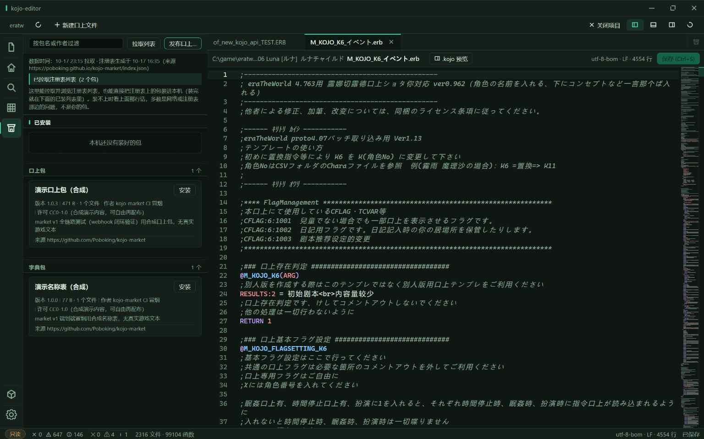

<div align="center">
  

# kojo-editor

[简体中文](README.md) | **English** | [日本語](README_JA.md)


**An editor for era-series game script sources (`.ERB` / `.kojo`).**  
Find the function you need, read other people's scripts, get told while you type, ship to the game in one click. Windows 10 / 11.

</div>

<div align="center">
  
  <br><sub>Cursor on a call site, press <code>F12</code> — land on the definition in <b>another file</b></sub>
</div>

## Highlights

- **Browse by structure, no memorizing long names.** One tree: character → family → face → function; the tool assembles names like `M_KOJO_K12_MESSAGE_COM_310` for you. Hovering a function shows the comment block the author wrote above it, which beats staring at uppercase names.
- **Other people's `.ERB` become readable.** Open a file from the game directory and `IF` / `PRINTFORMW` display in place as "if …:" plus plain lines of dialogue, with indentation instead of `ENDIF`. **Display only — not one byte of the file changes**, and `Ctrl+Alt+T` flips it back any time.
- **The IDE moves you expect, across files.** Go to definition `F12`, peek `Alt+F12`, implementation `Ctrl+F12`, find references `Shift+F12` (peek widget, hits grouped and counted per file), rename `F2` (call sites updated too), hover for comments and parameters, signature help, `Ctrl+Shift+O` for symbols, occurrence highlight and smart select.
- **Mistakes surface while you type, not after you test in game.** Wrong function names, incomplete families, a branch with no fallback, suspicious conditions — a squiggle on the line, click to jump. The status bar keeps a running count, `Ctrl+Shift+M` opens the problems panel, `Alt+F8` steps through.
- **Encoding and line endings preserved byte-for-byte.** Files are read with their declared encoding (Shift-JIS / GBK / UTF-8 / UTF-16) and written back with the original EOL and BOM shape: editing one line never reformats the file, and a Shift-JIS file does not silently become UTF-8.
- **Game directories are read-only by default.** The first real keystroke asks; the unlock lasts for that file and that session, and protection returns after a restart. Your own work lives in a separate script-project workspace that is always writable, so authorization never blocks writing.
- **Your own work is managed separately and ships in one click.** A new project gives you eight starter face files plus a Chinese README, and you pick the license (LTOL / CC BY-NC / MIT / BSD-2 / ISC / none). **Export** produces a publishable zip; **Deploy** shows you the target path before writing. If the target exists it errors instead of overwriting, and if a transpile fails the whole batch is refused — no half-built package.
- **No need to boot the game to check.** State replay tells you whether a line fires with an existing save and which branch it takes; the state injector sets variables into a *test* save, with a second confirmation, automatic backup and read-back verification.
- **Want to know when a line actually plays?** The condition matrix lays state keys against timing faces in one table; click a filled cell to jump straight to the script behind it.
- **Searchable, rebindable, extensible.** 100+ commands in the palette — anything the UI can do is findable there, and keys can be rebound. Built-in `.kojo` tutorial and syntax tables show how to write it, what it compiles to and what the error says. The script market pulls a registry and installs packages published by others, verifying sha256 file by file.

## Download and install

Get it from [Releases](https://github.com/Poboking/kojo-editor/releases/latest):

- **Installer** `kojo-editor_<version>_x64-setup.exe` — run it and follow the wizard; later versions update from "Settings → Update".
- **Portable** `kojo-editor_<version>_x64-portable.zip` — unzip and run `kojo-editor.exe`, nothing written to the registry. Needs the WebView2 runtime (preinstalled on Windows 11; on Windows 10 you may need to [install it](https://developer.microsoft.com/microsoft-edge/webview2/) first).

Every release ships `SHA256SUMS.txt` so you can verify the download. The installer is **not code-signed**, so Windows may show "protected your PC" on first run — "More info → Run anyway" is the way through.

## First run

1. On the welcome page, click "Select game directory" and pick your eraTW root;
2. it then asks about write access — **say no if you only want to read**; browsing, linting and replay keep working;
3. open a character's `.ERB` from "Script files" on the left — the first time, it asks whether to turn on `.kojo` preview;
4. to write your own: "My script projects" on the left → "+ New".

The full manual (creating a project, export and deploy, choosing a license, the safety notes on state injection) is in
[docs/USER-GUIDE.md](docs/USER-GUIDE.md) (Chinese for now).

## Running from source

```bash
corepack enable
pnpm install
pnpm --filter @kojo/app tauri dev      # development run (first cargo build takes 20–30 min)
pnpm --filter @kojo/app tauri build    # produce the installer
```

Requires Node.js 22, pnpm 11.22.0 and Rust stable (MSVC). The environment matrix, verification commands, plugin and adapter development and the release flow are in [docs/DEVELOPER-GUIDE.md](docs/DEVELOPER-GUIDE.md).

## FAQ

| Question | Answer |
|---|---|
| Will it damage my game directory? | It is read-only by default; only paths you approve can be written. Files are backed up before each write, and the original encoding and line endings are kept. |
| Which games are supported? | 8 era-series games are wired up. eraTW is the most polished; eraFL keeps its scripts in XML data files; coverage varies for the rest. |
| Does it conflict with editing `.ERB` directly? | No. Native files stay editable as they are; the readable surface syntax is just an optional way to view them. |
| Is there a macOS / Linux build? | Not yet — Windows 10 / 11 x64 only. |
| I installed something and nothing changed in game? | The engine only reads `.ERB`. Use "Export" or "Deploy" instead of copying source files into the game directory. |

## Documentation

| Document | For |
|---|---|
| [docs/USER-GUIDE.md](docs/USER-GUIDE.md) | script authors: how to use it (no implementation detail; Chinese) |
| [docs/DEVELOPER-GUIDE.md](docs/DEVELOPER-GUIDE.md) | developers: environment, verification, plugins and adapters, releasing |
| [docs/KOJO-2.0-LANGUAGE-SPEC.md](docs/KOJO-2.0-LANGUAGE-SPEC.md) | the `.kojo` language specification |
| [docs/STATE.md](docs/STATE.md) | test and performance readings, known debt |
| [AGENTS.md](AGENTS.md) | rules and commands for AI collaborators |

## Contributing

Welcome. Please read [AGENTS.md](AGENTS.md) first (invariants and collaboration discipline), and skim
[docs/PITFALLS.md](docs/PITFALLS.md) before you start. Adding a game? [docs/DIALECT-AUTHORING.md](docs/DIALECT-AUTHORING.md).
Opening an issue before a pull request saves everyone work.

## Screenshots and demos

The animations were recorded from the real UI and one command replays them
(see [docs/DEVELOPER-GUIDE.md](docs/DEVELOPER-GUIDE.md) §8); all demo data is synthetic.
The still screenshots come from the 2026-10-20 interface — panel placement shifts batch to batch,
so trust the app over the picture.

<table>
  <tr>
    <td width="50%" align="center"><br><sub><b>Find references</b> <code>Shift+F12</code> — see which files call it before you change one</sub></td>
    <td width="50%" align="center"><br><sub><b>Completion</b> — nothing pops inside dialogue, comments or strings</sub></td>
  </tr>
  <tr>
    <td width="50%" align="center"><br><sub><b>Folding</b> — collapse by function body and block</sub></td>
    <td width="50%" align="center"><br><sub><b>Command palette</b> <code>Ctrl+Shift+P</code> — search commands, rebind keys</sub></td>
  </tr>
  <tr>
    <td width="50%" align="center"><br><sub><b>Project-wide search</b> — for when you only remember a line</sub></td>
    <td width="50%" align="center"><br><sub><b>Main window</b></sub></td>
  </tr>
  <tr>
    <td width="50%" align="center"><br><sub><b>Condition matrix</b> — click a filled cell to jump to the script</sub></td>
    <td width="50%" align="center"><br><sub><b>Syntax tables</b> — how to write it, what it compiles to, what the error says</sub></td>
  </tr>
  <tr>
    <td width="50%" align="center"><br><sub><b>Script market</b> — install packages published by others (shown: synthetic demo packages)</sub></td>
    <td></td>
  </tr>
</table>

## License

[GPL-3.0-or-later](LICENSE). The repository contains no game content: the animations and screenshots here come from
synthetic samples, and the real corpora used by tests are only ever read, from directories installed locally and
authorized by the user.

Thanks to eraTW and the whole era community for years of authoring.

Author: [**Poboking**](https://github.com/Poboking) · bugs and ideas welcome in [Issues](https://github.com/Poboking/kojo-editor/issues)
