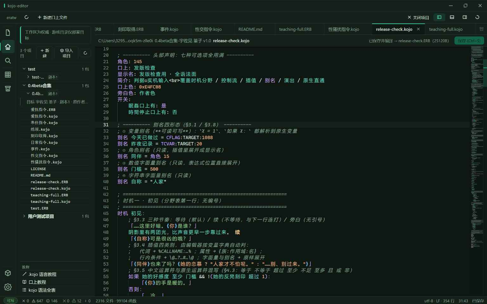
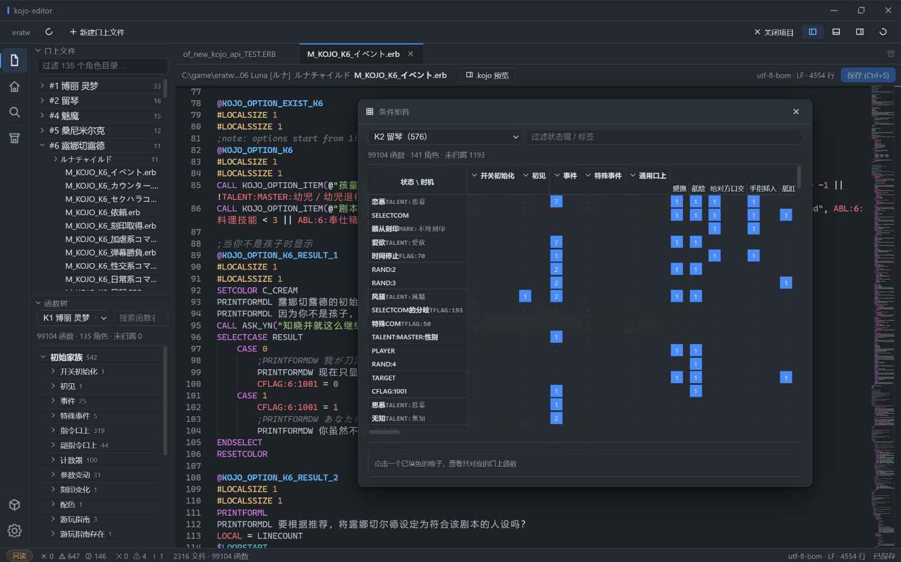
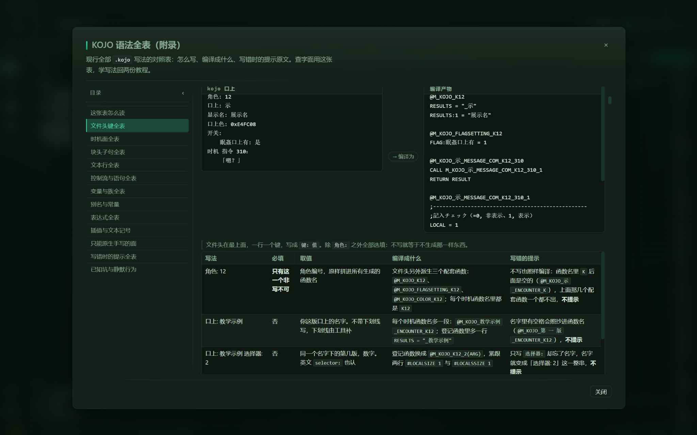
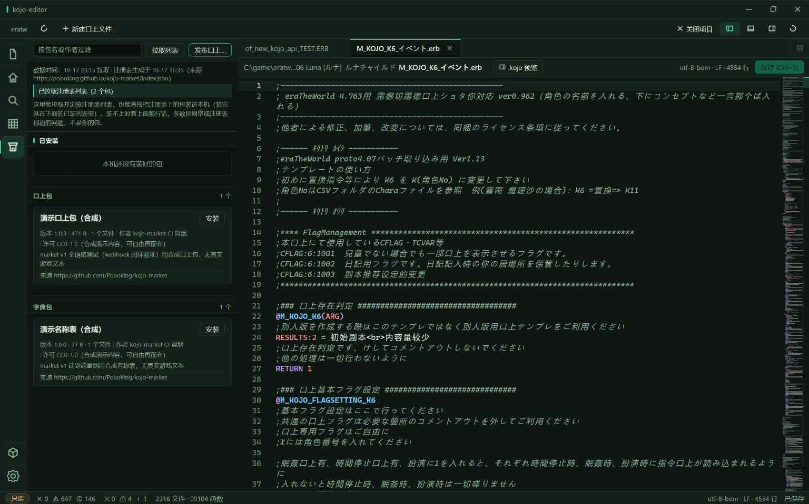

<div align="center">  
  

# kojo-editor

[简体中文](README.md) | **English** | [日本語](README_JA.md)


> A structure-aware editor for Kojo (call-name script) authors.  
> Thousands of script files, tens of thousands of functions —  
> browse, validate, write, and replay, all in one place.  
> No more "Notepad + full-text search".



</div>

---

## Why

The Kojo ecosystem of era games (eraTW and friends) has grown enormous:  
2,000+ script files and 90,000+ functions. Yet the tools authors work with  
are still Notepad and grep.

Which means, every day:

- One wrong letter in a function name and **an entire script silently dies** —  
  nobody speaks in-game, and nothing reports an error;
- Want to know when a line of dialogue triggers? Full-text search, then digging  
  through dozens of same-named functions;
- Changing one line means "launch the game → grind to the right state →  
  eyeball it" — deep conditions cost fifteen minutes of grinding;
- File encodings are all over the place, and one bad save ruins the text.

kojo-editor turns all of this into "open it and see, save it and know".

## What it does

**🗂 Structured browsing**  
Point it at your game directory: script files grouped by character, functions  
expanded as a "character → family → face" tree with condition badges at a  
glance. 90,000+ functions indexed in seconds.

**🧭 Condition matrix**  
Lay out the whole project as a matrix of "state / timing × event / face", with the  
number of matching functions in each cell. Click a cell to jump straight to the  
corresponding Kojo functions. Chinese/Japanese labels, unassigned buckets and  
virtual scrolling keep even 100k-function projects responsive.



**✅ Mistakes surface immediately**  
Misspelled function names, incomplete families, malformed syntax — the  
convention checker lists every problem; click one to jump straight to the  
offending line. Errors no longer fail silently.

**✍️ Write in the ".kojo language"**  
A writing language designed for Kojo, with a natural Chinese feel like  
`如果 好感度 ≤ 5：` ("if affection ≤ 5:"). On save it compiles back to the  
script format the game reads natively — original encoding and line endings  
preserved, byte for byte. Prefer hand-writing? Both styles mix freely.

**📖 Syntax reference (appendix)**  
Every `.kojo` form, its value, generated output and the warning you get when it is  
written incorrectly — all in one table inside the tutorial overlay.



**⌨️ Completion that feels like VS Code**  
ERB directives, variable families, `#DIM` declarations, user functions, `$labels` and  
the native `.kojo` zone all complete; suggestions pop up as you pause, with adjustable  
delay, and stay quiet in dialogue, narration and comment lines. Go-to-definition,  
find references, rename, inlay argument hints, signature help, breadcrumbs and folding  
are covered too.

**▶ State replay**  
Pick a save file and a character: every trigger condition's truth value and  
branch outcome laid out in a panel. Test your writing without grinding the game.

**💉 State injection**  
Need a specific affection value for testing? Write it into a **test save** —  
two-step confirmation, automatic backup, read-back verification. Real saves  
and the game itself stay read-only, always.

**🛒 Kojo market**  
Browse, install and update Kojo packs and dictionary packs inside the app, filtered  
by package name or author. The publish wizard takes a workspace or a plain ZIP pack,  
pre-validates it locally and opens a market review PR — no GitHub steps for authors.



**🛡 Data safety and stability**  
Saves go through the write-permission boundary and atomic writes; external edits  
support three-way merge, dirty files are never silently overwritten. Operation-level  
undo, trash and batch rollback are always available. Autosave, crash recovery,  
multi-root workspaces, tabs and split editors keep long sessions safe.

## Installation

**Windows 10 / 11 (x64)** — download from [Releases](https://github.com/Poboking/kojo-editor/releases/latest):

- **Installer**: `kojo-editor_0.4.1_x64-setup.exe` — double-click to install;  
  afterwards "Settings → Update" checks and installs future versions.
- **Portable**: `kojo-editor_0.4.1_x64-portable.zip` — unzip and run, no registry  
  entries or Start-menu items. Update by downloading the latest zip  
  (Windows 11 includes the required WebView2 runtime; Windows 10 may need it installed).

First launch: pick your game directory → automatic indexing → done.  
Everything except writing works without granting write permission  
(browsing, checking, and replay are all read-only).

## Development

```bash
pnpm test               # full suite (functional + timing pools, 7700+ passing)
pnpm typecheck          # type checks (root + app)
pnpm audit:decoupling   # "everything is a plugin" decoupling audit
pnpm --filter @kojo/app tauri dev   # desktop shell (first build ~20-30 min)
```

The architecture is **everything-is-a-plugin**: the kernel knows nothing about  
any specific game — adding a game means adding one adapter plugin.  
Design details live in [ARCHITECTURE.md](docs/ARCHITECTURE.md);  
contribution workflow in [AGENTS.md](AGENTS.md).

## Roadmap

| Version       | Scope                                                              | Status         |
| ------------- | ------------------------------------------------------------------ | -------------- |
| v0.1          | Kernel + plugin runtime + desktop shell                            | ✅              |
| v0.2          | Validation / navigation / condition extraction / replay / injector | ✅              |
| v1.0–v1.1     | Snapshot replay + state injector                                   | ✅              |
| v0.3          | .kojo language end-to-end (edit, compile, save)                    | ✅              |
| v0.4.0-beta.1 | Save loop · file watching · auto-update · settings · packaging     | ✅              |
| v0.4.1        | Kojo market · condition matrix · syntax reference · completion + performance | ✅              |
| v0.4.2-beta.1 | eraAkumaMaid adapter · tree-sitter syntax layer · editor feel batch · ERB language service · search/completion · split & navigation | 🧪 Pre-release |
| v0.4.2-beta.2 | Kojo 2.0 track (off by default) · ERB structural folding · undo stack never cleared · find state persists · read-only & EOL truth · updater honors proxy | 🧪 Pre-release (current) |

## Feedback

Found a bug or have an idea? [Open an issue](https://github.com/Poboking/kojo-editor/issues).

Developer: [**Poboking**](https://github.com/Poboking)  
<a href="https://github.com/Poboking"></a>

## License

[GPL-3.0-or-later](LICENSE) (kernel and tool code).

This repository ships no game content — screenshots and test data come from a  
locally installed copy of the game. Thanks to eraTW and the entire era  
community for years of creative work.
