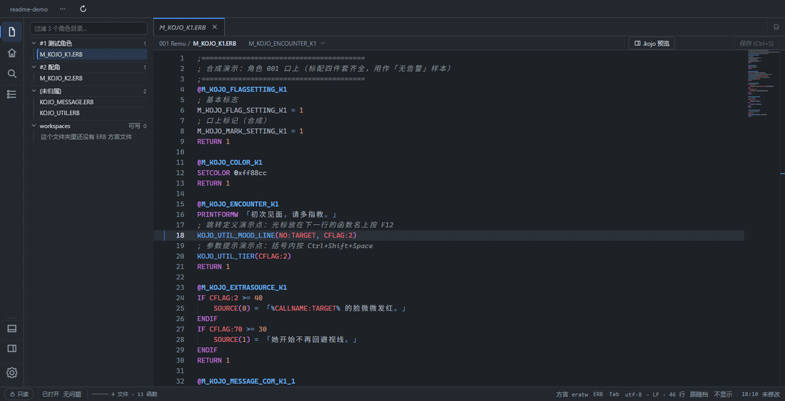
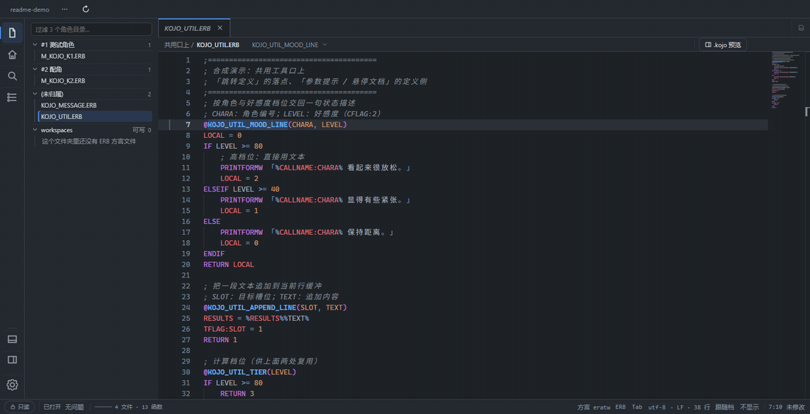
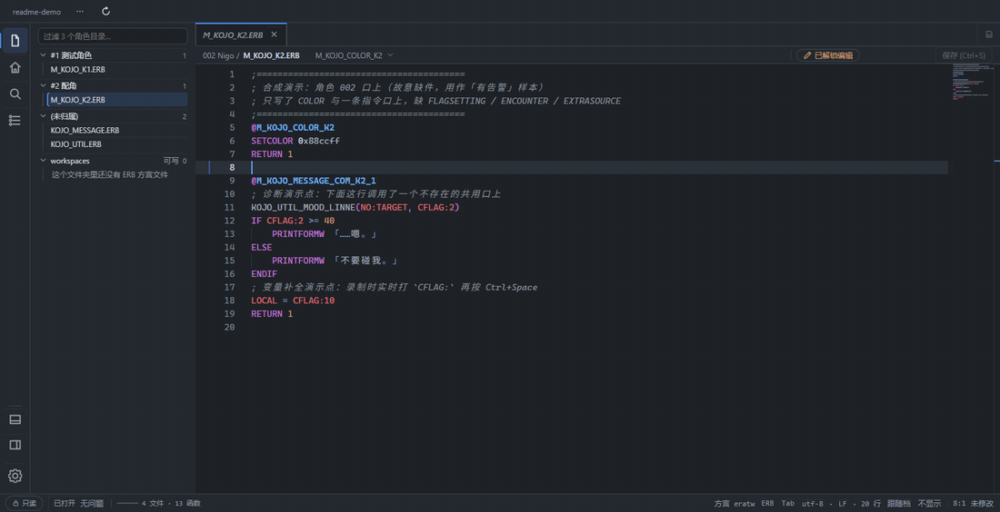
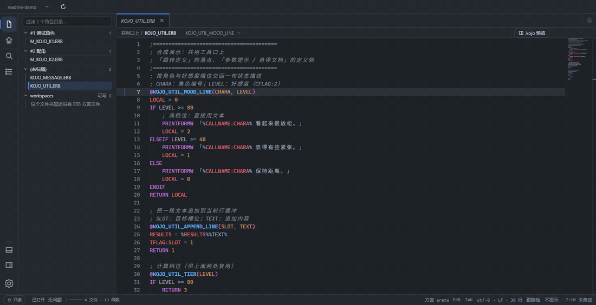
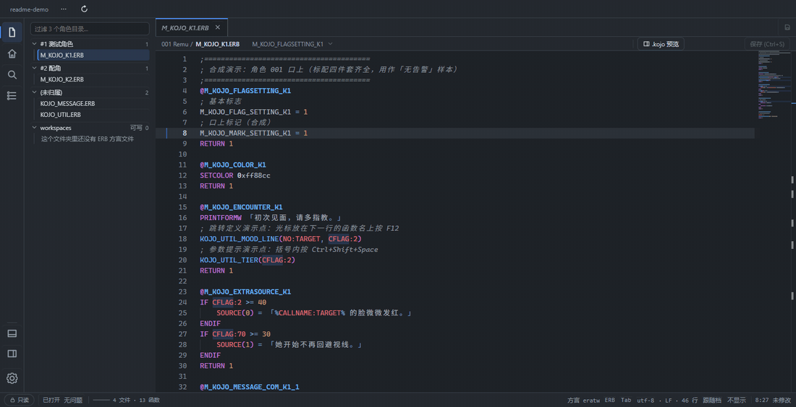
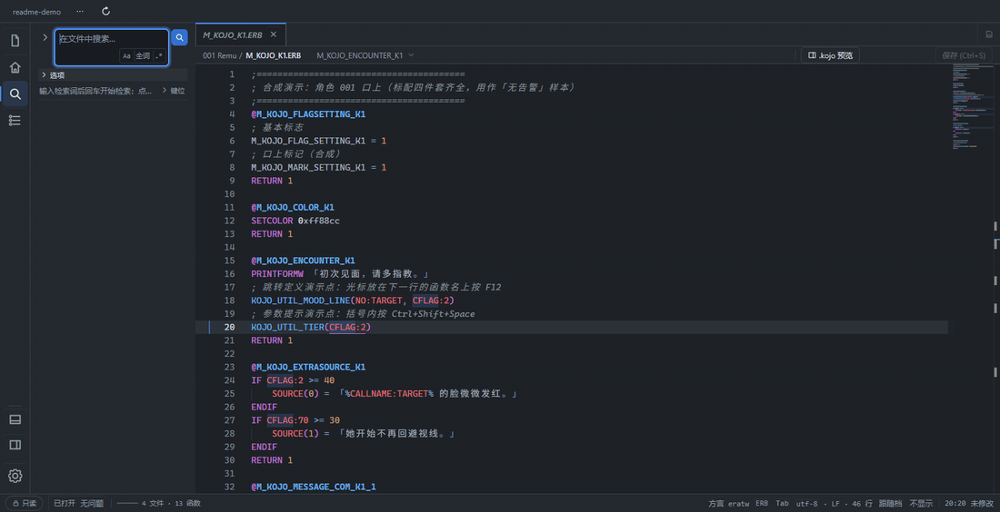
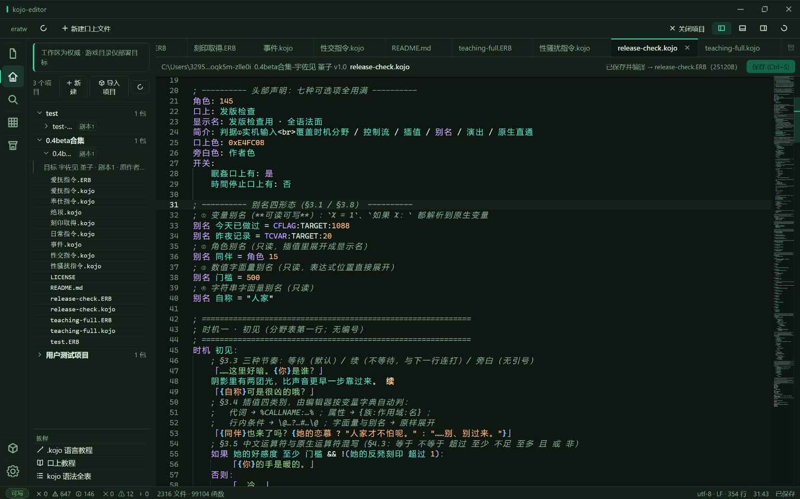
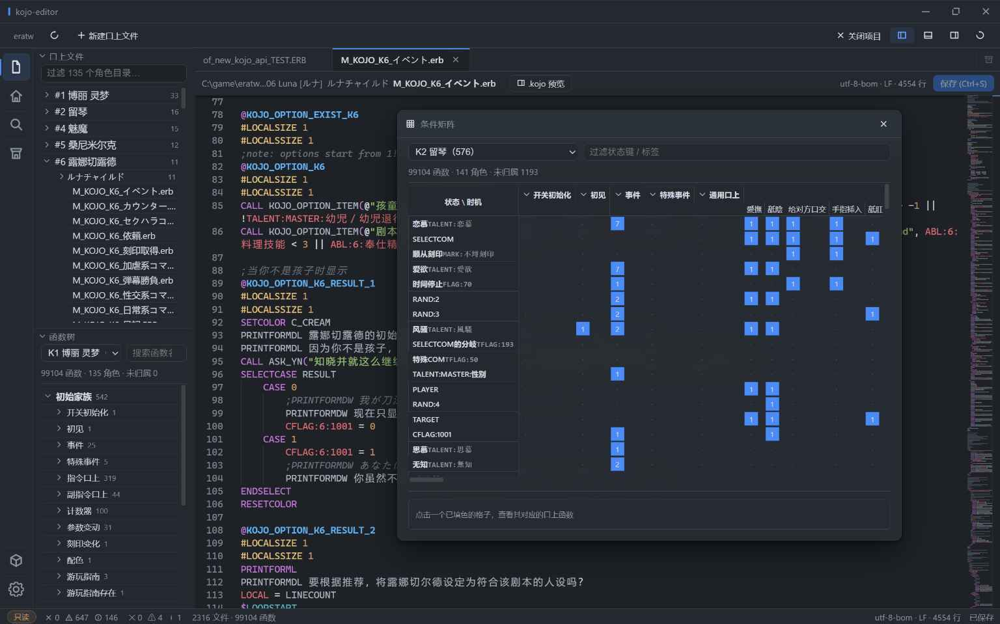
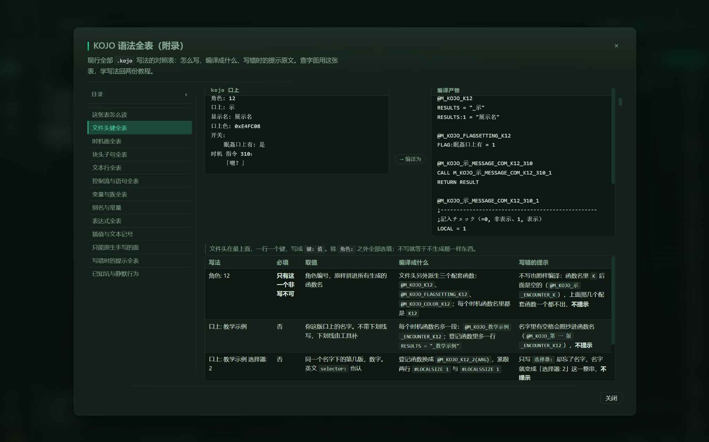
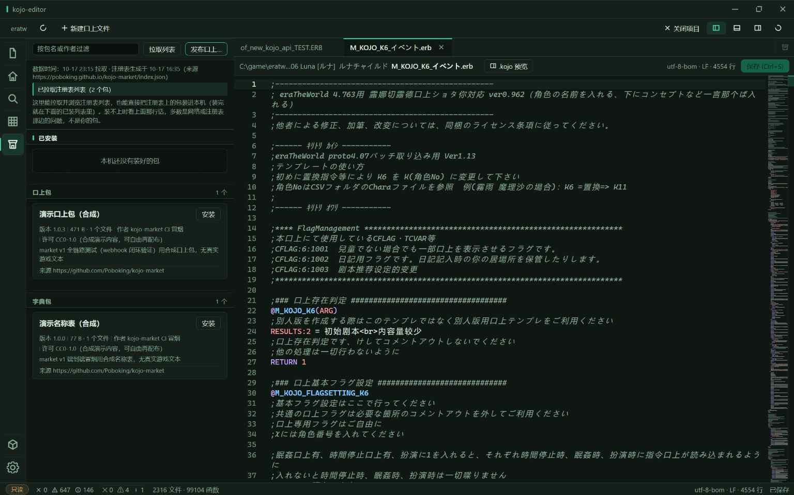

<div align="center">
  

# kojo-editor

[简体中文](README.md) | [English](README_EN.md) | **日本語**


**era 系ゲームの口上スクリプト（`.ERB` / `.kojo`）用エディタ。**  
関数が見つかる、他人の口上が読める、書きながらミスに気づける、出来たらワンクリックでゲームに入る。Windows 10 / 11。

</div>

<div align="center">
  
  <br><sub>呼び出し側に光标を置いて <code>F12</code> —— <b>別のファイル</b>の中の定義へ飛ぶ</sub>
</div>

## できること

- **構造で探す**：キャラ → 一族 → 面 → 関数のツリーをたどるだけ。`M_KOJO_K12_MESSAGE_COM_310` のような全名を覚えなくて済みます。
- **他人の `.ERB` が読める**：`IF` / `PRINTFORMW` がその場で「もし …：」と台詞行に表示されます。**表示だけ**で、ファイルは 1 バイトも変わりません。
- **いつもの IDE 動作**：定義へ移動、参照の検索、一括改名（ファイル横断）、ホバーで作者コメント、引数ヒント、シンボルへ移動。
- **ミスはその場で**：関数名の打ち間違い、一族の不足、分岐の兜底漏れを行に波線で示し、クリックで飛びます。
- **自分の作品は別管理**：自分の口上プロジェクトに書き、「エクスポート」で zip 配布、「デプロイ」でゲームディレクトリへ。
- **ゲームを起動して試さなくていい**：状態リプレイが今のセーブデータで「この台詞が出るか」を答え、状態インジェクタで必要な状態に作れます。

## デモ

<table>
  <tr>
    <td width="46%" align="center"></td>
    <td valign="middle"><b>参照の検索</b> <code>Shift+F12</code><br>1 人の口上を変える前に、呼び出し側がどのファイルにあるか確認できます。</td>
  </tr>
</table>

<table>
  <tr>
    <td valign="middle"><b>補完</b> <code>Ctrl+Space</code> / 入力即表示<br>台詞・コメント・文字列の内側では出ません。候補が意味を持つ位置だけに出ます。</td>
    <td width="46%" align="center"></td>
  </tr>
</table>

<table>
  <tr>
    <td width="46%" align="center"></td>
    <td valign="middle"><b>たたみ</b><br>関数本体・ブロック単位で畳めます。数万行の口上は、畳めて初めて読めます。</td>
  </tr>
</table>

<table>
  <tr>
    <td valign="middle"><b>コマンドパレット</b> <code>Ctrl+Shift+P</code><br>画面でできることはここで検索できます。キーの割当もここから。</td>
    <td width="46%" align="center"></td>
  </tr>
</table>

<table>
  <tr>
    <td width="46%" align="center"></td>
    <td valign="middle"><b>プロジェクト全体検索</b><br>台詞の一節や断片しか覚えていないときに。ヒットはファイル別にまとまります。</td>
  </tr>
</table>

## 画面

<table>
  <tr>
    <td width="50%" align="center"><br><sub><b>メイン画面</b></sub></td>
    <td width="50%" align="center"><br><sub><b>条件マトリクス</b> —— 色付きのマスから該当する口上へ</sub></td>
  </tr>
  <tr>
    <td width="50%" align="center"><br><sub><b>文法全表</b> —— 書き方・コンパイル結果・エラー文</sub></td>
    <td width="50%" align="center"><br><sub><b>口上マーケット</b> —— 他の作者のパッケージを導入</sub></td>
  </tr>
</table>

## ダウンロードとインストール

[Releases](https://github.com/Poboking/kojo-editor/releases/latest) から：

- **インストール版** `kojo-editor_<バージョン>_x64-setup.exe`：ウィザードどおり進める。以降の版は「設定 → 更新」でワンクリック。
- **緑版** `kojo-editor_<バージョン>_x64-portable.zip`：解凍して `kojo-editor.exe` を実行。レジストリ書き込みなし。WebView2 実行環境が必要（Windows 11 は同梱、Windows 10 は[先に導入](https://developer.microsoft.com/microsoft-edge/webview2/)することがあります）。

各 Release に `SHA256SUMS.txt` を同梱しています。インストールパッケージは**コード署名なし**なので、初回起動で「Windows は PC を保護しました」が出ることがあります。「詳細情報 → 実行」で進んでください。

## 最初の起動

1. ウェルカム画面で「ゲームディレクトリを選択」を押し、eraTW のルートを選ぶ；
2. 続いて書き込み許可を聞かれます——**読むだけなら断って構いません**、閲覧・検証・リプレイはそのまま使えます；
3. 左の「口上ファイル」からキャラの `.ERB` を開くと、最初に「`.kojo` プレビュー」を使うか尋ねられます；
4. 自分用なら：左の「我的口上项目」（自分の口上プロジェクト）→「＋ 新建」（新規作成）。

詳しい手順（プロジェクトの新規作成、エクスポート / デプロイ、ライセンスの選び方、状態インジェクタの安全説明）は
[docs/USER-GUIDE.md](docs/USER-GUIDE.md)（現在中国語のみ）にあります。

## ソースから動かす

```bash
corepack enable
pnpm install
pnpm --filter @kojo/app tauri dev      # 開発実行（初回 cargo ビルドは 20〜30 分）
pnpm --filter @kojo/app tauri build    # インストーラ生成
```

Node.js 22・pnpm 11.22.0・Rust stable（MSVC）が必要。環境マトリクス、検証コマンド、プラグインとアダプタ開発、リリース手順は [docs/DEVELOPER-GUIDE.md](docs/DEVELOPER-GUIDE.md) に。

## よくある質問

| 質問 | 回答 |
|---|---|
| ゲームディレクトリを壊さない？ | 既定は読み取り専用。許可したパスだけ書けます。書く前は自動バックアップ、エンコーディングと改行は元のまま。 |
| 対応ゲームは？ | era 系 8 本につながっています。eraTW が最も丁寧に作り込み、eraFL は口上が XML データファイル。残りは適用度がまちまちです。 |
| `.ERB` を直接編集するのと衝突しない？ | しません。原生の書き方は今までどおり編集でき、読みやすい表層表記は選択肢です。 |
| macOS / Linux は？ | まだありません。Windows 10 / 11 x64 のみ。 |
| ゲームに入れても反応がない | エンジンは `.ERB` しか読みません。「エクスポート」か「デプロイ」を使い、源ファイルを直接コピーするのは避けてください。 |

## ドキュメント

| 文書 | 対象 |
|---|---|
| [docs/USER-GUIDE.md](docs/USER-GUIDE.md) | 作者向け：使い方（実装の話はしない。中国語） |
| [docs/DEVELOPER-GUIDE.md](docs/DEVELOPER-GUIDE.md) | 開発者向け：環境・検証・プラグインとアダプタ・リリース |
| [docs/KOJO-2.0-LANGUAGE-SPEC.md](docs/KOJO-2.0-LANGUAGE-SPEC.md) | `.kojo` 言語仕様 |
| [docs/STATE.md](docs/STATE.md) | テスト・性能の読み値と未完了項 |
| [AGENTS.md](AGENTS.md) | AI 協力向けの規則とコマンド |

## 貢献

歓迎します。着手前に [AGENTS.md](AGENTS.md)（不変条件と協力の規律）をお読みください。落とし穴集は
[docs/PITFALLS.md](docs/PITFALLS.md)。ゲームを 1 本増やすには [docs/DIALECT-AUTHORING.md](docs/DIALECT-AUTHORING.md)。
PR を出す前に Issue で一言いただけると、無駄な作業を防げます。

## ライセンス

[GPL-3.0-or-later](LICENSE)。リポジトリにゲーム内容は同梱していません——この文書のアニメーションとスクリーンショットは
すべて合成サンプル由来で、テストが使う実コーパスはユーザー自身が導入し許可したディレクトリを**読み取りのみ**で扱います。

eraTW と era コミュニティ長年の創作に感謝します。

開発者：[**Poboking**](https://github.com/Poboking) · 要望・不具合は [Issue](https://github.com/Poboking/kojo-editor/issues) へ
