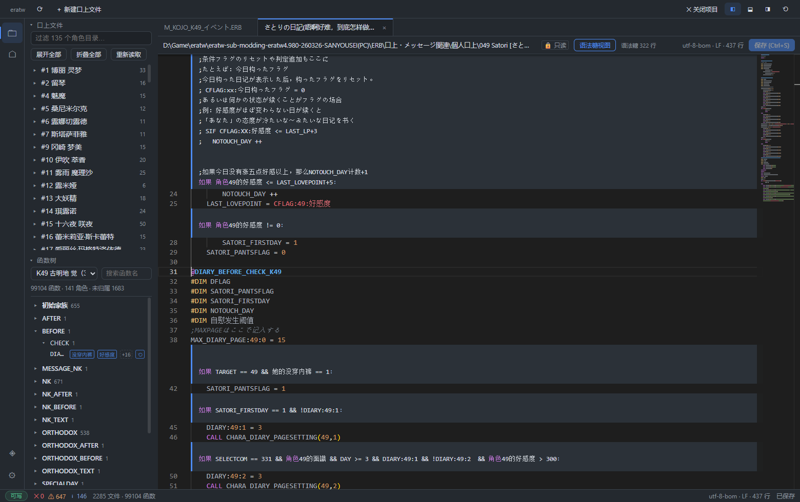

<div align="center">  
  

# kojo-editor

[简体中文](README.md) | [English](README_EN.md) | **日本語**


> 口上（こうじょう）作者のためのエディタ。  
> 数千ファイル・数万関数のコウジョウを、「メモ帳と全文検索」から解放します。  
> 閲覧・チェック・執筆・リプレイを、これひとつで。



</div>

---

## なぜ作ったのか

era シリーズ（eraTW など）の口上シーンは、すでに大きな規模に達しています：  
2,000 を超える口上ファイル、9 万を超える関数。  
ところが作者の手元にある道具は、いまだにメモ帳と全文検索のまま。

その結果、こんなことが日常的に起きています：

- 関数名を一文字でも書き間違えると、**その口上は黙って動かなくなる**——  
  ゲーム内で誰も喋らないし、エラーも出ない。
- 「この台詞はいつ発火するのか」を知りたいだけなのに、  
  同名関数の山を全文検索で漁るはめに。
- 台詞を一行直すたび「ゲームを起動 → 該当状態まで進める → 目視確認」。  
  深い条件になると十数分の grinding。
- 文字コードはファイルごとにバラバラ。保存した瞬間に文字化け。

kojo-editor は、これらを「開けば分かる、直せば確かめられる」に変えます。

## できること

**🗂 構造化ブラウズ**  
ゲームディレクトリを開くと、口上ファイルはキャラクター別に整理され、  
関数は「キャラ → 家族 → 面」のツリーで展開。条件バッジがひと目で分かり、  
クリック一つで該当行へ。9 万を超える関数も、インデックスは数秒。

**✅ 書き間違いはその場で検出**  
関数名のタイプミス、家族の欠落、書式不一致——「規約チェック」パネルが  
問題をリストアップし、クリックで該当行へジャンプ。もう黙って壊れない。

**✍️ 「.kojo 言語」で書く**  
口上のために設計された日本語/中国語感覚の記述言語：  
`もし 好感度 ≤ 5：` といった語感で書けば、保存時にゲームがそのまま読める  
スクリプトへ自動コンパイル——元の文字コード・改行コードは一字も崩しません。  
書きたくない部分は元ファイルのまま手書きでも OK、両方の混在ができます。

**▶ 状態リプレイ**  
セーブデータとキャラを選ぶと、全ての発火条件の真偽と分岐の行き先が  
一覧で表示されます。ゲームを回して状態を整える必要はもうありません。

**💉 状態インジェクション**  
好感度を特定の値に合わせてテストしたい？ **テスト用セーブ**に書き込みます——  
二段階確認・自動バックアップ・読み返し検証つき。実セーブとゲーム本体は常に読み取り専用。

## インストール

現在はソースからのビルドが必要です（v0.4.0-beta.1 でプレビルド版を公開予定）：

```bash
# 前提：Node.js 22+ と Rust ツールチェーン（rustup）
pnpm install
pnpm --filter @kojo/app tauri dev   # 初回コンパイルは 20-30 分ほど
```

初回起動：ゲームディレクトリを選択 → 自動認識・インデックス → 完了。  
書き込み権限を承認しなくても、閲覧・チェック・リプレイはすべて読み取り専用で使えます。

## 開発

```bash
pnpm test               # 全テスト（2473+ passed。ゲーム未設定時は一部統合テストを自動スキップ）
pnpm typecheck          # 型チェック（root + app の二重実行）
pnpm audit:decoupling   # 「すべてはプラグイン」設計の監査
```

アーキテクチャは**すべてプラグイン**：コアはゲーム知識ゼロ。  
新しいゲームへの対応 = アダプタプラグインを一つ追加するだけ。  
詳細は [ARCHITECTURE.md](docs/ARCHITECTURE.md)、  
コントリビューションの流れは [AGENTS.md](AGENTS.md) をどうぞ。

## ロードマップ

| バージョン         | 内容                                    | 状態     |
| ------------- | ------------------------------------- | ------ |
| v0.1          | コア + プラグインランタイム + デスクトップシェル           | ✅      |
| v0.2          | チェック / ナビゲーション / 条件抽出 / リプレイ / インジェクタ | ✅      |
| v1.0–v1.1     | スナップショットリプレイ完成 + 状態インジェクタ             | ✅      |
| v0.3          | .kojo 言語フルチェーン（編集・コンパイル・保存）           | ✅      |
| v0.4.0-beta.1 | 保存ループ・ファイル監視・自動更新・設定ページ・配布            | 🚧 進行中 |

## フィードバック

不具合やご要望は [Issues](https://github.com/Poboking/kojo-editor/issues) へどうぞ。

開発者：[**Poboking**](https://github.com/Poboking)  
<a href="https://github.com/Poboking"></a>

## ライセンス

[GPL-3.0-or-later](LICENSE)（コアおよびツールコード）。

本リポジトリはゲームコンテンツを一切含みません——スクリーンショットやテストに使った  
口上ファイルは、すべてローカルにインストールされたゲームから来ています。  
eraTW と、長年にわたり作品を積み上げてきた era コミュニティに感謝を。
